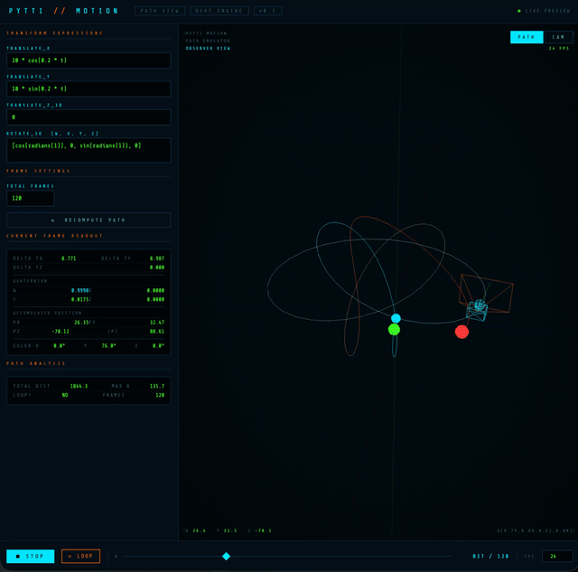

# PYTTI // MOTION PREVIEW

> Real-time 3D path visualizer for PyTTI animation transforms

**[→ Live Demo](https://pxl-pshr.github.io/pytti-motion-preview)**



A browser-based tool for previewing the camera motion that PyTTI will produce from your `scene.yaml` transform expressions — before running a single diffusion step. Paste in your `translate_x`, `translate_y`, `translate_z_3d` and `rotate_3d` expressions, or a whole preset, and see the accumulated camera path rendered live in 3D.

---

## What it does

PyTTI's 3D mode warps each frame with a per-frame transform: every point `p` moves to `R·(p + t)`, where `t` is the translation and `R` the `rotate_3d` quaternion. Evaluated frame after frame, these deltas add up to a camera path: a small turn each frame compounds into an arc, translations combined with turns make spirals and orbits. This tool runs that same math and draws the result.

**Two views:**

- **PATH** — An observer camera orbits the whole trajectory. Drag to orbit, scroll to zoom, double-click to reset. The frustum shows the camera's pose at the current frame, and the line runs cyan → orange from start to end.
- **CAM** — First-person view through the PyTTI camera, moving through a reference world of floor, pillars and floating markers in PyTTI's pixel units (about 1000 px per metre of depth with the default near and far planes). The world repeats around the camera, so long moves never leave it.

---

## Parameters

Expressions are Python, read the way PyTTI reads them:

- `t` is **time in seconds**: frame / `frames_per_second`. Set FPS in the panel to your config's value; it changes the path, not only playback.
- Python's `math` module is in scope without a prefix: `sin`, `cos`, `radians`, `sqrt`, `pi`, `e`, `tau`, `atan2`, `log`, `floor` and the rest, plus `abs`, `min`, `max`, `pow` and `round`. Python is case-sensitive: `pi`, not `PI`.
- Python operators work as in Python: `**`, `//`, `%`, `and`, `or`, `not`, comparisons and `x if condition else y`.
- `r`, `R` and `mu` are PyTTI's nearest, farthest and typical depth of the current image, in pixels. They depend on the image, so the panel lets you set values to test with.

```yaml
translate_x:    '-1700*sin(radians(1.5))'      # pixels per frame
translate_y:    '0'
translate_z_3d: '(50+10*t)*sin(t/10*pi)**2'    # positive moves into the scene
rotate_3d:      '[cos(radians(1.5)), 0, -sin(radians(1.5))/sqrt(2), sin(radians(1.5))/sqrt(2)]'  # [w, x, y, z]
```

That's PyTTI's default 3D motion: it circles a point about 1200 px into the scene and pushes forward every 10 seconds.

### Directions

These follow PyTTI's `zoom_3d`:

| Setting | Positive value |
|---|---|
| `translate_x` | Shifts the image right: the camera moves left |
| `translate_y` | Shifts the image up: the camera moves down |
| `translate_z_3d` | Moves the camera forward, into the scene |
| `rotate_3d` x | Tilts the camera up |
| `rotate_3d` y | Turns the camera right |
| `rotate_3d` z | Rolls the image clockwise |

To turn `a` degrees per frame about an axis `(x, y, z)`, use `[cos(radians(a/2)), x*sin(radians(a/2)), y*sin(radians(a/2)), z*sin(radians(a/2))]`. PyTTI doesn't normalize `rotate_3d`, so a quaternion whose length isn't 1 also scales and skews the frame; the tool shows a warning when that happens.

### lock_camera

PyTTI's `lock_camera` is on by default. It subtracts the average motion of every frame, which cancels `translate_x`, `translate_y` and turning up, down, left or right, leaving only parallax. Rolls and `translate_z_3d` are unaffected. The preview shows the path with `lock_camera: false`, and Copy YAML sets it.

---

## Expression examples

| Effect | translate_x | translate_y | translate_z_3d | rotate_3d |
|---|---|---|---|---|
| Orbit, 360° in 120 frames | `-3000*sin(radians(1.5))` | `0` | `0` | `[cos(radians(1.5)), 0, -sin(radians(1.5)), 0]` |
| Pan right 1°/frame | `0` | `0` | `0` | `[cos(radians(0.5)), 0, sin(radians(0.5)), 0]` |
| Dolly in | `0` | `0` | `30` | `[1, 0, 0, 0]` |
| Push-pull every 4 s | `0` | `0` | `40*sin(2*pi*t/4)` | `[1, 0, 0, 0]` |
| Tunnel roll | `0` | `0` | `30` | `[cos(radians(1)), 0, 0, sin(radians(1))]` |
| Figure-8 | `20*cos(pi*t/4)` | `10*cos(pi*t/2)` | `0` | `[1, 0, 0, 0]` |
| Crane up, tilt down | `0` | `-10` | `10` | `[cos(radians(0.15)), -sin(radians(0.15)), 0, 0]` |

All of these are in the Presets menu.

---

## PyTTI config in and out

Works with [pxl-pshr/pytti](https://github.com/pxl-pshr/pytti) presets, the YAML files in `app/config/conf/`:

- **⧉ Copy YAML** copies a preset: `# @package _global_`, `animation_mode: '3D'`, the four expressions in single quotes, `frames_per_second` and `lock_camera: false`. Paste it into a preset, or
- **↓ .yaml** saves it as a file. Put it in `app/config/conf/` and press refresh next to Load Config.
- **⇪ Import** loads a preset or config: paste it into the box, drop a `.yaml` file anywhere on the page, or press Ctrl/Cmd+V with nothing focused. It reads the four expressions and `frames_per_second`, works out the frame count from `scenes`, `steps_per_scene`, `steps_per_frame` and `pre_animation_steps`, takes `R` from `far_plane`, and warns about `lock_camera: true` or an unquoted `rotate_3d`. `key = value` lines from a notebook work too.

---

## Controls

| Control | Function |
|---|---|
| Expression inputs | Live recompute on edit (400ms debounce); errors show under the field with the frame PyTTI would fail on |
| Frames / FPS | Animation length, and the rate that turns frames into `t` |
| r / R / mu | Depth values for expressions that use them |
| ↻ RECOMPUTE | Force recompute |
| PATH / CAM toggle | Switch view mode |
| Drag / wheel / double-click | Orbit, zoom and reset the PATH view |
| ▶ PLAY / ■ STOP, Space | Play back the animation |
| ← / → | Step one frame |
| ⟳ LOOP | Toggle looping |
| Timeline scrubber | Seek to any frame |

The panel shows the current frame's deltas and raw `rotate_3d`, the camera's position relative to where it started (right, up, forward) and its pitch, yaw and roll, plus path analysis: total distance, max radius, and whether the motion loops, with how far the pose after the last frame lands from the start.

---

## Stack

Single-file, zero build step. Pure HTML/CSS/JS + [Three.js r128](https://threejs.org/) via CDN.

```
index.html                  landing page
pytti-motion-preview.html   the tool
```

No dependencies to install. No bundler. Open it in a browser or serve it statically anywhere. Expressions are interpreted by a small Python-subset evaluator in the page, not run as JavaScript.

---

## Local use

```bash
# Clone
git clone https://github.com/pxl-pshr/pytti-motion-preview
cd pytti-motion-preview

# Open directly — no server needed for basic use
open pytti-motion-preview.html

# Or serve locally
python3 -m http.server 8000
```

---

## Related

- [PyTTI](https://github.com/pytti-tools/pytti-core) — the diffusion animation framework this previews
- [pxl-pshr/pytti](https://github.com/pxl-pshr/pytti) — PyTTI with a local UI and presets; Copy YAML and Import target its preset format
- [PyTTI-Tools](https://github.com/pytti-tools) — extended tooling ecosystem
- [quaternions.online](https://quaternions.online) — quaternion reference and visualizer

---

*by [pxl-pshr](https://github.com/pxl-pshr)*
